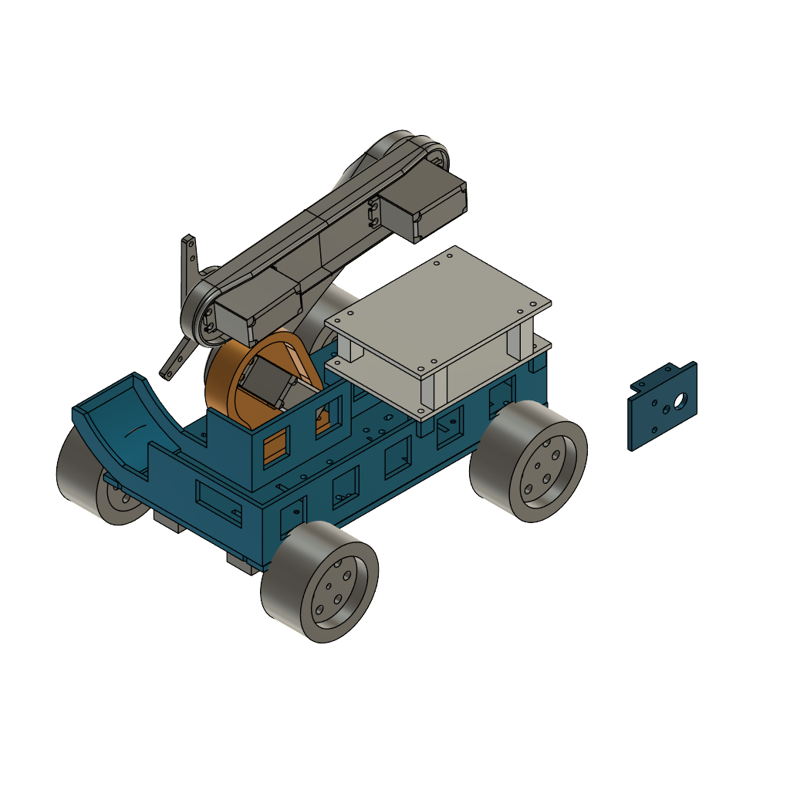
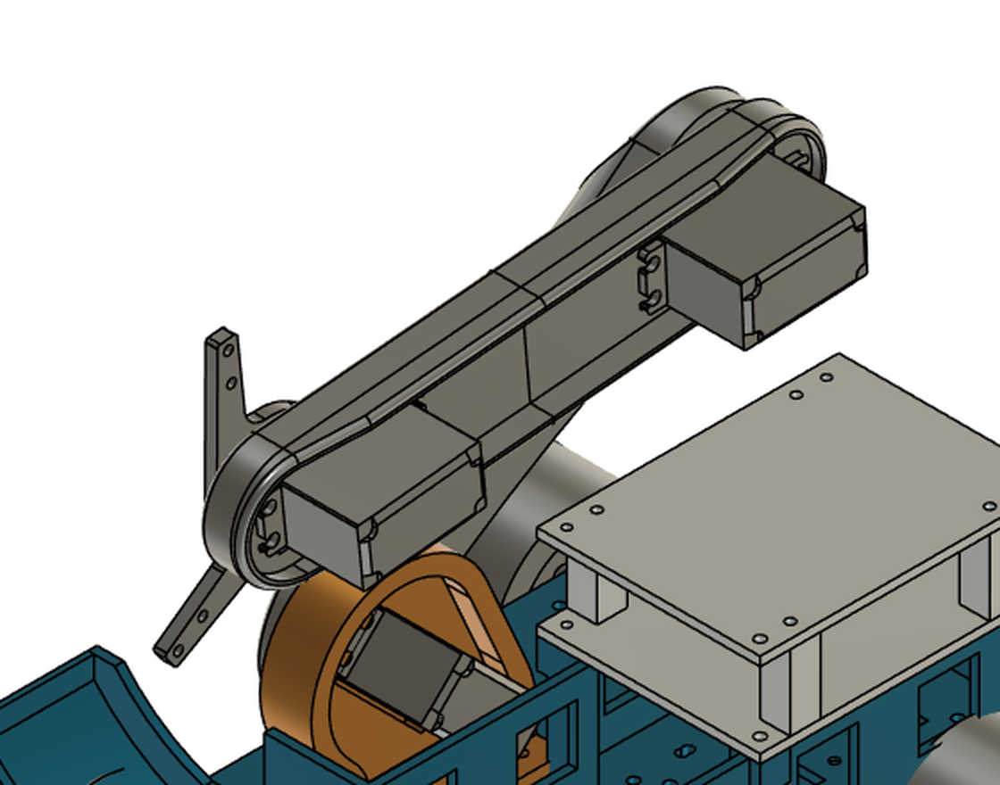
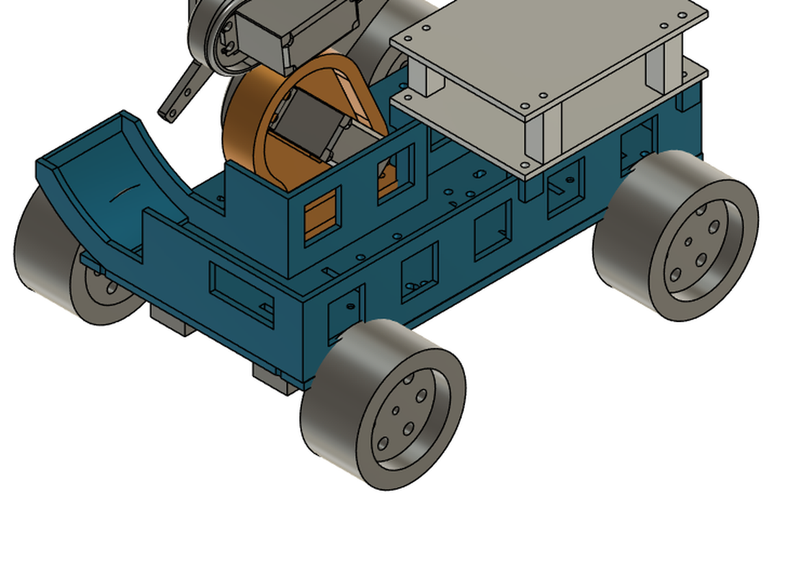
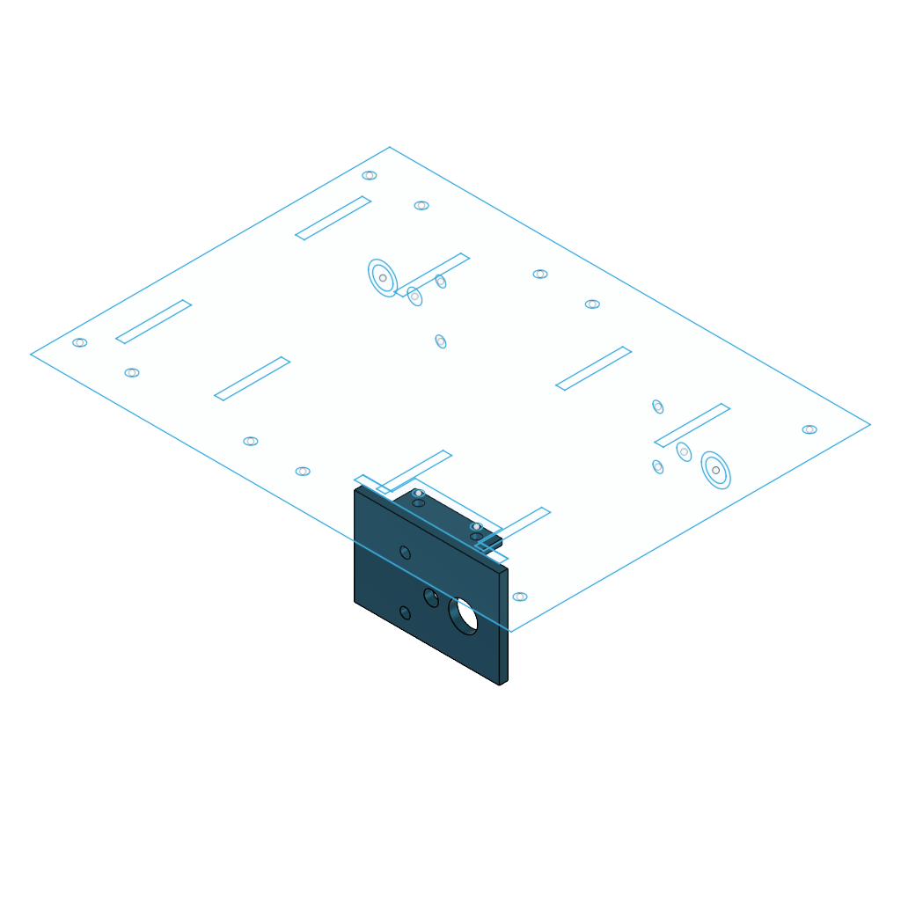

# 机械结构日志：从滚刷收集到三爪机械臂（V1 → V8）

> 本文件记录 CRTC2026 参赛机器人**收集机构与整车结构**的完整演进过程。
> 素材来源：`历程/` 目录下 8 个章节的建模与交付记录、`机械/` 目录下两套模型、`V5到V7/` 目录下 6 份设计与检查文件、V8 的 Fusion 归档 `docs/assets/02-机械结构日志/V8.f3z`。
> 组织方式遵循手册要求：以**单个功能为一个 H2 板块**，每个板块内按**完成时间从早到晚**叙述「构思 → 选型 → 实现 → 踩坑 → 迭代」。
> 最后更新：2026-10-16

---

## 版本总览与一句话结论

| 版本 | 日期 | 一句话定义 | 收集方式 | 行走 | 关键尺寸（长×宽×高 mm） | 打印件 |
|---|---|---|---|---|---|---|
| 起点 | 10-01 | 自研滚轮轮芯 + 软轮套 | 摩擦接触（软筒） | — | 轮芯 Ø36×80，包套后 Ø44 | 轮芯 1 + 端盖 2 |
| 第二章 | 10-02 | 毛刷式滚轮（6 条可换条刷） | 毛刷拨送 | — | 名义外径 Ø60，有效宽 80 | 轮芯 1 + 压盖 2 |
| **V1** | 10-02 | 双毛刷滚轮车（折叠进料） | 毛刷拨送 + 斜导料板 | 四轮差速 | 展开 376.5×167×160 / 折起 285.7×167×198 | 39 |
| **V1.1** | 10-04 | 补齐实车数据（换麦轮） | 同上 | 麦克纳姆 | 展开 376.5×173.24×160 / 折起 285.7×173.24×198 | 43 |
| **V2** | 10-03 | 取消折叠、一体打印底盘 | 毛刷加宽加密 | 麦克纳姆 | 固定 280×180×175 | 22 |
| **V3** | 10-04 | 回归硬齿滚轮（单片式） | 硬齿拨送 + 梳齿导流 | 麦克纳姆 | 全转角 277×189.24×171.2 | 27 |
| **V3.2** | 10-05 | 取消梳板、末端改导出坡道 | 硬齿拨送 + 坡道导出 | 麦克纳姆 | 同 V3 | 3 件改动 |
| **V4** | 10-10 | 升降夹取车（举升取核方案） | 主动夹取 + 举升回仓 | 麦克纳姆 | 初始 286.00×193.62×208.99 | 40 种候选 |
| **V5** | 10-13 | 三爪转盘机械臂（同步带版） | 三爪夹取 + 转盘换位 | 麦克纳姆 | 沿用 V4 底盘 | 未单列 |
| **V6** | 10-14 | 三爪机械臂（大扭矩舵机版） | 同上 | 麦克纳姆 | 收拢 281.0×188.5×205.0 | 45 |
| **V7** | 10-14 | 三爪机械臂（现有舵机适配版） | 三爪夹取 + 转盘换位 | 麦克纳姆 | 初始 281.0×187.0×209.14 | 44 |
| **V8** | 10-16 | **三爪机械臂 + 独立电控盒（最终版）—— 当前版本** | 三爪夹取（**换位改由新增的腕关节承担**；转盘的传动与承重结构已为减重取消） | 麦克纳姆 | 未标注（CAD 未给包络，须实测） | 未清点（CAD 未给零件数） |

**V1→V4 的结论：两台完全同构的举升取核车（V4 平台复制两台）**，理由见文末「最终选型」一节。
**2026-10-13 的调整：2 号车改走三爪机械臂路线（V5 → V7）；V4 的举升取核车保留为可用平台**（V5 起的三份文件都写明「不覆盖 V4 文件」）。
**2026-10-14 的定案：1 号车与 2 号车完全同构，两台都做 V7 三爪机械臂车**（参赛分组确认为新生组）。
**2026-10-16 的最终版：V8（`V8.f3z`）**——整车重新建模，V7 的"沿用 V4 底盘 + 后装机械臂"被一体化重做取代。V8 的 CAD 内部把新件编号为 **V9 / V10**（组件级版本号，与整车版本号不同），文件名为 `V8.f3z`；**V7 的机构与电控在 V8 之前的结论仍然有效，除被 V8 明确取代的部分外不重复推翻**。详见下文「V8：最终版整车」一节。

---

## H2 · 早期演进（V1 → V3.2）：为什么最终放弃了"拨送"

> V4 之前共 7 个中间版本（含两个部件级尝试），它们全部建立在同一个假设上——**靠旋转件把方块"拨"进仓**。
> 本节只保留这条路线上的**关键取舍、否决理由与量化结论**；每个版本的完整过程见文末「素材索引」中的对应章节。

### 这条路线做成了什么

把"拨进仓"从零做到能用：自研轮芯 → 毛刷式滚轮 → 整车折叠 → 换真麦轮 → 砍掉折叠 → 硬齿滚轮 → 取消梳板。
最终 V3.2 的整圈保守包络 **277×189.24×171.2 mm**，对手册初始限制 290×195×210 的余量 **13×5.76×38.8 mm**。

### 技术选型：四次关键取舍

| 取舍 | 放弃的方案（理由） | 采用的方案 | 依据 |
|---|---|---|---|
| 取物方式 | **光面软筒**：靠摩擦"搓"，对**镂空的框**（方块内部 15³ 镂空、12 条棱 45° 倒角）咬不住棱边，打滑后没有备份 | **毛刷滚轮**：毛束能**扫进镂空框**并勾住棱边，接触柔性、不挑姿态，条刷可单独更换 | 几何推理 + 维护性 |
| 行走 | **四轮差速**：不能横移，30 mm 方块的精确对位要靠反复倒车 | **Ø60×30.62 麦克纳姆轮**（官方物资表即有 60 mm 麦轮） | 全向平移直接提升对位效率 |
| 折叠 | **90° 折叠进料模块**：换来的只是"初始尺寸更小"，代价是**重心、落下速度、限位强度**三项都要用实物试验去换 | **固定进料 + 一体打印底盘**：包络 280×180×175，余量 10×15×35，无铰链 / 无释放舵机 / 无锁扣 | 不折叠也能满足初始限制 → **能砍就砍** |
| 拨送件 | **毛刷**：软接触，抓取率**只能实测**、无法用几何证明"一定能咬住"，且刷毛散开使动态包络不可控 | **硬齿滚轮**：可对齿形做**全转角几何检查**，能证明"齿先于护板接触" | 可证明性 > 直觉 |

### 踩坑与解决（只保留最值钱的六条）

| 现象 | 定位过程 | 根因 | 对策 |
|---|---|---|---|
| 条刷两端刷毛被压盖套边顶出 | 装配顺序推演 → 套边只覆盖底座、不覆盖刷毛 | 两端刷毛伸进了套边 | 每端约 3 mm 区段剪到接近底座，**保留原厂压线与根部固定结构，不拔出毛束** |
| 模型里那排"黑色梳齿"被误认为待打印的硬齿 | 对照装配树 `PRINT` / `BUY` 前缀 | 黑色梳状外形只是**尼龙毛束的简化示意** | 在交付说明中写明；**这个误会后来在 V3 又出现过一次**，并直接导致了 V3.2 取消梳板 |
| "抓力不够就加长刷毛" | 从力学关系反推 `F = T / r` | **刷毛更长通常更柔软**；且**轮径更大时，同样轴扭矩下切向推力反而更小** | 不靠加长刷毛：改为 ①加宽 80→100 ②刷条 6→8 ③芯径 36→44 ④**2:1 减速提高可用轴扭矩**。理想推力比 `2×30/34 ≈ 1.76`，并**明确注明这不是实测的抓取提升** |
| V1.1 能否直接借用 V2 的轮毂转接件 | 比对两者轴端盲孔终点 | **V1 盲孔终点距车中心 61.55 mm**，与 V2 不同 | 出**专用转接件、不可混用**，并把这一条写进说明 |
| 方块会不会先撞在护板上被推开（V3） | **不靠目测**：按滚轮每 0.05° 计算齿形与 Z=0~30 mm 的交线，覆盖一个完整的 72° 齿形周期（**1440 个转角**） | 需要证明是"齿先接触"而不是"护板先接触" | **每个转角都有硬齿在 0~30 mm 高度内先于护板接触**，最小几何前伸 **15.998 mm**。**边界只对"30 mm 高、正向进入有效齿宽、直立方块、平地"成立**，不承诺斜撞、翻倒方块或超出齿宽的物体 |
| 取消梳板后方块能否脱离齿片（V3.2） | 检查原 V3.1 底托末端形状与出口高度 | **原末端接近竖直、中心出口高约 59.4 mm**，是抬升 / 回带的敏感区——所以"滚轮不碰底托"**不能**推出"方块一定能脱离齿片" | 底托末端改**连续导出坡道**（末端 X=−12、Z=52，与仓底齐平）。**出口几何才是回带与否的决定因素**，必须单独验证 |

### 迭代优化里沉淀下来的两条工程习惯

- **"每多一个转接件，就多一处要试配的配合面和一次扭矩传递损失。"**
  V3 据此删除了 V1.1 引入的 4 个车轮转接件，改为行走电机中心内移 15 mm + 直接使用现有 25.5 mm 联轴器。
- **先打单件试配，再打整套。**
  V1 先打 8 mm 短环验证软轮套越挡边（需约 **6.1% 周向伸长**）；V3 先打 1 片 `Rotor_Slice` + 1 个隔圈试配 Ø6 轴、嵌件、紧定螺钉与梳齿间隙。
  另：**不要把 STL 文件数当成打印件总数**——V3 是 **17 种文件、27 件**。

### 当前状态与遗留（早期版本）

拨送路线整体**已被 V4 放弃**，不再继续投入。其中仍然有效的资产：条刷底座 5×5 与压盖套边限位、M3 热熔嵌件底孔 Ø4.2 深 4、轴孔试配间隙，以及**全转角包络与接触顺序的验证方法**（被直接用于 V4 的 7 姿态包络检查）。
早期版本**始终未做**：连续折叠路径扫掠、应力分析、驱动扭矩、整车质量、抓取成功率、卡料、皮带打滑、实物收集试验。
V1 的初始长向余量仅 **4.3 mm**，**刷毛散开 + 线缆 + 紧固件突出**尚未核算。

---

## H2 · V4：升降夹取车（10-10）——举升取核方案

### 目标与验收标准
V1~V3 都建立在同一个假设上：**靠旋转件把方块"拨"进仓**。这个假设带来一组无法消除的问题——拨送式机构只能收**地面附近**的方块，而本届赛场 5 个能量核心（每个 4 分）里有 **3 个不在平地上**：两个挂在 **e3 / d6 物资架**上（挂点质心离地 **250 mm**）、一个在**中央高地焦点平台**上（平台高 70 mm）；另外两个在 **d1 / e8 台阶下的洞穴**里（洞口 70×70×50 mm）。

**所以 V4 的目标是换掉"收集方式"本身：从被动拨送改为主动举升夹取，让同一台车能同时覆盖地面、洞口、台阶附属平台和 250 mm 悬挂四种高度。**

### 技术选型对比

| 候选 | 覆盖高度 | 能否取洞口/悬挂 | 结论 |
|---|---|---|---|
| 滚刷/硬齿拨送（V1~V3） | 仅地面附近 | 不能 | 放弃 |
| 举升 + 夹爪（V4） | 夹取参考中心 **离地 15–255 mm** | 能（配合水平伸缩 122 mm） | **采用** |

### 实现过程

**行走**：沿用 **4 个 TT 电机 + 60 mm 麦克纳姆轮 + 现有马达联轴器尺寸**；车轮外观简化为包络实体。

**升降与夹取（核心）**：
- **两级独立升降，每级行程 0–120 mm**；**水平回收 0–122 mm**。
- **三个 MG995** 分别驱动两级升降与水平伸缩；**SG90 驱动夹爪**。
- 传动为 **齿条 + 齿轮**：`Lift_A_Gear_58T` / `Lift_B_Gear_58T`（各 34.947 cm³ 实体体积）、`Retract_Gear_52T`（27.986 cm³）、`Horizontal_Rack`（46.116 cm³）。
- **夹爪从方块上半部外侧夹持**，给占据通孔的**悬挂杆让路**。
- **250 mm 悬挂块对应总升降 235 mm**（两级叠加）。

**动作时序**：地面取物 → **竖直抬升** → 回收到仓口上方 → 张爪卸料 → 向前伸出 → 降回目标高度。
**关键约束**：**必须先升高再回收——不能在低位把夹爪横移进储仓。**

**储仓**：固定侧壁 + 后壁的**一体筒体**，底部紧固件接底盘，**顶盖可检修**；**入口保持固定开口，省去翻板驱动与回位弹簧**。电池后部低位、驱动/电源模块中层、面包板与主控上层。

### 遇到的问题与解决

| 现象 | 定位过程 | 根因 | 对策 |
|---|---|---|---|
| 悬挂块取不出来 | 算水平回收行程 vs 悬挂杆长度 | **122 mm 伸缩 < 150 mm 悬挂杆** | 悬挂块须**沿杆轴朝自由端退出**，必要时**配合整车后退**；明确标注**该动作未做实物验证** |
| 夹爪会撞到悬挂杆 | 观察方块几何（中间是通孔） | 悬挂杆占据方块通孔 | 夹爪**改从方块上半部外侧夹持**，绕开杆 |
| 舵机扭矩怎么传到齿条 | 检查打印件接口 | 打印花键强度不可信 | 明确写入：**模型孔位是占位设计，不得依靠打印花键直接传递舵机扭矩**；必须试装舵机原配舵盘，测输出轴位置与固定孔距 |
| 装配后包络超标 | 初始态逐对实体检查 | 结构紧凑 | 初始实体包络 **286.00×193.62×208.99 mm**，**宽度仅余 1.38 mm、高度仅余 1.01 mm** |

### 迭代优化
用 `Pose_Robot2.py` 做**位置布置检查**（明确声明"不是动力学或碰撞仿真，齿轮不随动"），预设 5 个姿态：

| 编号 | 姿态 | LiftA | LiftB | Retract | 夹爪角 |
|---|---|---|---|---|---|
| 0 | 收拢 | 0 | 0 | 0 | 0 |
| 1 | 地面张爪 | 0 | 0 | 0 | 5° |
| 2 | 150 mm 台阶 | 75 | 75 | 0 | 5° |
| 3 | 悬挂块 | 120 | 115 | 0 | 5° |
| 4 | 入仓 | 65 | 65 | 122 | 12° |

**7 个离散位置的包络检查结果**（均 286.0×193.62×高，跨运动组结构件未检出超阈值重叠；齿轮—齿条啮合与双夹爪齿轮对不计入）：

| 姿态 | 包络高 / 尺寸 mm |
|---|---|
| liftA_mid | 268.99 |
| liftA_top | 328.99 |
| liftB_mid | 388.49 |
| hanging（250 mm 取物） | **443.49** |
| highest | **448.49** |
| unload_mid | 285.497×193.62×338.49 |
| unload | **337.50**×193.62×338.49 |

模型统计：**76 个实体**、40 个候选打印件（均单一实体）、初始态全部实体对**无 >0.1 mm³ 重叠**、检查 75 项。

### 当前状态与遗留

**仍待定型**：螺钉长度及防松、舵盘接口、齿轮相位与背隙、打印导轨承载与磨损、**升降断电保持**、线束固定。
**尚未核实**：**舵机供电不能假定与两节电池电压相容**；**降压模块持续电流未核实**。
**未实测**：容量目标约 **8 块，未做堆积试验**；悬挂杆退出动作未做实物验证。

**装配与验证顺序（5 步，按此顺序做能最早暴露问题）**：
1. **先打印配合试件**，按现有 K1 Max / PLA 参数选滑动间隙（手推顺畅、无明显侧摆）；
2. **单独做一级升降**，测齿条啮合、实际有效转角、带载保持，再装第二级；
3. **试装舵机原配舵盘**，测输出轴位置与固定孔距；
4. **测 30 mm 方块夹持、洞口进出及悬挂杆退出**，再装储仓；
5. **最后布线**，复测初始包络 / 运动包络 / 总重量 / 刹车时物资保持。

---

## H2 · 三爪机械臂（V5 → V7）：为什么不继续做"举升单爪"

> 2026-10-13 确认了一份新的设计输入（`V5到V7/设计输入确认_2026-10-13.md`），把 **2 号车**从"举升取核单爪"改向**三爪转盘机械臂**。
> 触发这次改动的是 V4 留下的三个未解问题：**一次只夹一块** → 单位时间吞吐低；**悬挂杆 150 mm 长于 122 mm 回缩行程** → 必须整车后退；**单爪要在"夹住"与"放开"之间反复切换** → 回仓次数多。
> 三爪方案把这三条一起改掉：一次连续夹 3 块、三只爪独立保持、装满再回仓。

### 目标与验收标准（2026-10-13 确认）

- **任务范围**：地面、附属低台、150 mm 台阶、250 mm 悬挂块；**明确放弃洞穴方块**（V4 曾把洞穴列为目标，此版放弃）。
- **布局**：前置储仓 → 右后两关节机械臂 → 左后电路仓；**底座不回转**，机械臂朝前工作。
- **末端**：竖直转盘装在小臂末端右侧，**盘面与机械臂俯仰平面平行**；三只夹爪按 **120° 均布**，开口运动在平行于盘面的平面内。
- **工作方式**：连续夹取并保持 3 块后一起回仓；**三只夹爪分别驱动、独立保持与释放**。
- **卸料**：储仓右侧区域正上方，**优先直接落仓**（以实际释放点定位仓口，不额外加横移机构）。
- **沿用**：现有轮组、TT 马达、电路与可用舵机，新增 MG90S。肩/肘扭矩不足时**首选买更大扭矩舵机**，不为沿用 MG995 而勉强定型。
- **制造**：K1 Max + PLA；交付 Fusion 模型 + 打印件清单 + 采购清单；**不导出 STL**。
- **允许**：重打底盘、初始折叠收纳、按需补标准五金。

### 三版速览

| 版本 | 日期 | 主驱动（肩 / 肘 / 转盘） | 转盘传动 | 夹爪驱动 | 备注 |
|---|---|---|---|---|---|
| **V5** | 10-13 | 3× **MG995**（沿用现有） | **2GT 同步带 40T→20T** | 3× MG90S | 首版；只出了五金与装配清单 |
| **V6** | 10-14 | 3× **DS3235-270**（新购候选） | 齿轮 40T→20T（反向 2×，扭矩减半） | 3× MG90S | 换大扭矩舵机；电源改用独立 UBEC |
| **V7** | 10-14 | 3× **MG996R 180°**（现有件） | 齿轮 52T→20T（反向 2.6×） | 3× MG90S | **当前版本**；转盘由金属轴 + 625 轴承承重 |

三版共同点：**前置储仓 + 右后两关节臂 + 左后电路仓 + 竖直转盘三爪**，且都**不处理洞穴方块**。

### 技术选型：三次关键取舍

| 取舍 | 放弃的方案（理由） | 采用的方案 | 依据 |
|---|---|---|---|
| 转盘传动 | **同步带**（V5 的 2GT 40T→20T）：要额外张紧，打印 40T 带轮的齿形强度未验证，齿形必须先与实物带做配合试验才敢用 | **模数 1 直齿轮**：齿形可校核、中心距可算、啮合状态肉眼可见 | **可校核性 > 减重**；V6/V7 都改为齿轮 |
| 主驱动舵机 | **MG995**（V5 沿用）：实际有效转角与可持续扭矩**均未确认** | **DS3235-270**（V6 候选）→ **MG996R 180°**（V7，用现有件） | 转盘与举升是主要负载，**不为沿用旧件而勉强定型**；V7 又退回现有舵机，目的是**先把接口样件做出来** |
| 舵机供电 | **原降压模块直带 6 只舵机**：电流能力未核实，舵机浪涌会拉低整条 5 V 母线 | **独立 UBEC（Hobbywing 10A，2–6S，设 6 V）+ 各路共地**；原降压模块只留逻辑支路 | **舵机电流不得经过面包板与杜邦线**（面包板接触电阻承受不了安级电流） |

### 传动与角度映射（V7）

齿轮全部为**模数 1**，三处关节各自独立：

| 位置 | 主动→从动 | 中心距 | 作用 |
|---|---|---|---|
| 肩部 | 22T→28T | 25 mm | 减速 28/22 |
| 肘部 | 24T→40T | 32 mm | 减速 40/24 |
| 转盘 | 52T→20T | 36 mm | **反向增速 2.6 倍**（输出扭矩相应减小） |

**转盘由金属轴 + 625 轴承承重，不能仅靠舵机输出轴悬臂支撑。**

模型初始姿态：肩角 0°、肘相对角 156°、盘面世界角 158°。令 `s` = 肩角、`e` = 肘相对角、`d` = 盘面世界角（单位度），一组**名义**指令映射为：

- 肩舵机：`175 − s × 28/22`
- 肘舵机：`10 + (156 − e) × 40/24`
- 转盘舵机：`50 − (d − s − e) / 2.6`

> **这不是可直接烧录的控制程序。** 需要在装舵盘时对正相位，再按实际方向、脉宽和端点重新标定；三只 MG90S 的开合角要用实物夹爪标定。已采样路线对应的名义舵机行程：肩 **14.2–175.0°**、肘 **10.0–157.8°**、盘 **7.1–172.2°**。
>
> **转盘只能按有限角度往返，不允许连续累积旋转**（线束必须往返管理，不允许累积绕圈）。盘面的**世界角不能直接当作转盘舵机角** —— 必须先减去肩、肘的转角，得到"转盘相对小臂的角"再映射。

### 负载核算（V7，估算值）

按实心 PLA 密度 1.24 g/cm³、MG996R 每只 55 g、MG90S 每只 15 g、每套机械爪假定 30 g、方块每块 11.29 g、齿轮效率假定 75% 估算：

| 关节 | 已采样路线的最大静态需求 | 结论 |
|---|---|---|
| 肩 | 约 **8.60 kgf·cm** | MG996R 标称 6 V 堵转 11 kgf·cm，而**堵转值不是持续许用值** → **不能认定单只 MG996R 肩驱动已满足可靠的三爪满载循环** |
| 肘 | 约 **4.34 kgf·cm** | 余量比肩大，但仍未实测 |

该估算**未计**线束、完整紧固件、加速冲击与实际摩擦，**不是实测，也不是有限元分析**。肩座及大臂已预留助力安装孔，但**没有定型弹簧、锚点附件或验证助力曲线**，不应把这些孔理解为"助力系统已完成"。

### 检查结果（V6 / V7 的几何检查）

| 项目 | V6（2026-10-14） | V7 |
|---|---|---|
| 收拢 / 初始包络 | 281.0×188.5×205.0 mm | **281.0×187.0×209.14 mm**（距 210 mm 高度上限**不足 1 mm**） |
| 离散姿态 | 8 个，未检测到非预期实体相交 | 8 个，无异常 |
| 运动抽样 | 151 个样本，无跨机构实体相交 | 151 个路径/转盘换位采样点，无异常 |
| 各轴最大包络 | 437.1×188.5×361.3 mm（各轴最大值可来自不同姿态） | 已采样路径约 **437.11×187.00×361.31 mm** |
| 特征健康异常 | 0 项 | 0 项 |
| 打印组件 | 45 个均保留且可见 | **44 个**（隐藏打印组件 0 个） |
| F3D 重导入 | 成功，收拢包络与导出前一致 | 成功 |
| 导出 | F3D + STEP 成功 | F3D + STEP 成功，**未导出 STL** |

检查设置：**检测阈值 0.1 mm³**；转盘扫描间隔 **10°**、路径各分 **10 段**；干涉检查**排除**预期的齿轮啮合与同一机械爪内部的简化联动件；使用 **30 mm 方块包络、每爪一块**。
> 检查**未加入**完整赛场障碍物、完整螺钉、线束与弹性变形，**运动抽样不等于连续扫掠证明**。

### 遇到的问题与解决

| 现象 | 定位过程 | 根因 | 对策 |
|---|---|---|---|
| 悬挂块取不出来（V4 遗留） | 算水平回收行程 vs 悬挂杆长度 | 回缩行程短于 **150 mm** 悬挂杆 | 悬挂块**沿杆朝自由端退出**，允许**整车后退**；**完全脱杆后才能旋转转盘** |
| 肩关节带载能力存疑（V7） | 按密度与质量逐件加总，估算静态力矩 | 6 V 堵转 11 kgf·cm 与估算 **8.60 kgf·cm** 之间**没有真正的余量**，且堵转值不是许用值 | 新增**助力安装预留孔**（但不宣称已定型）；建议**先做接口与单臂样件**，低速测空载 / 1 块 / 3 块时的电流、温升与位置保持；**不得靠提高供电超过额定范围补偿** |
| 装完才发现启动高度只剩不到 1 mm | 逐对实体检查初始姿态包络 | 三爪 + 转盘 + 大臂叠加 | 启动姿态 **281.0×187.0×209.14 mm** → 真实装配**必须复测最高点、螺钉头与线束**（模型未计螺钉与线束） |
| 打印 40T 同步带轮的齿形不敢直接用（V5） | 检查打印齿形与实物带的配合 | 打印齿形精度不足以直接啮合同步带 | **改为齿轮传动**（V6/V7）：齿形可校核、中心距可算 |
| 舵机总在 5 V 母线上引起主控复位 | 观察舵机动作与主控复位的相关性 | 舵机浪涌电流经过面包板 / 杜邦线 | **独立 UBEC 供舵机 + 各路共地**；舵机电流**不经过面包板与杜邦线** |

### 迭代优化

- **V5 → V6**：把转盘传动从同步带换成齿轮，主驱动从 MG995 换成 DS3235-270，电源从"原降压模块"换成独立 UBEC。**三处改动都指向同一个目标：把"能不能用"从"要靠实测才知道"变成"可以先算出来"。**
- **V6 → V7**：不再等新舵机到货，**先用现有 MG996R 180° 做出适配版**，把舵机托座、舵盘避让、腕部主动轴位置（**后移 6 mm**）与支架全部重做；转盘改为 52T→20T 并加 625 轴承承重。**目的是把"接口"和"结构"先落地，把"扭矩够不够"这条留给样件实测。**
- **两个版本都保留**：V7 文件明确"**保留 V6 文件**"，因为 V6 的 DS3235 路线在换舵机后仍有价值。

### 当前状态与遗留

**V7 是 CAD 试制评审版，不能标记为可直接参赛的定型产品。** 尚未完成：强度校核、持续工作温升、夹持成功率、整车实称、**肩部负载余量实测**。
**待实测的接口**：夹爪实际开口、MG90S 与爪齿轮接口、DS3235 舵盘孔位及安装耳、打印后孔轴配合、齿轮背隙、夹持力。
**待复核的包络**：装齐螺钉与线束后的 **290×195×210 mm 启动包络**与 **445×400×450 mm 工作包络**。
**其他未做**：三块同时持有的可靠性、散装入仓成功率、仓内堆积影响、完整赛场障碍物干涉。

---

## H2 · 机械爪（三指夹爪）：自研自打印件

> 这一节单独立板块，因为**机械爪是本项目唯一同时决定"能不能夹住"和"能不能装下"的零件**，也是我们**自制程度最高**的一件——**三只机械爪由我们自己设计、自己用 K1 Max 打印，不使用采购成品爪**。

### 目标与验收标准

- 能稳定夹住 **30×30×30 mm** 的镂空方块（内部 15³ 镂空、12 条棱 45° 倒角），**不靠爪尖附件**；
- 夹持点**避开方块中心通孔**（悬挂时 14 mm 杆从这里穿过）；
- 与 MG90S 输出轴可靠连接，**不用打印花键直接传扭**；
- 整件用 **K1 Max + PLA** 打印，装配厚度与质量可控，能装进 V7 的启动包络；
- **可重打更换**：爪体是单一实体，损坏或改版时直接重打，不依赖外购件补货。

### 技术选型：为什么自己打印，而不是买现成的

| 候选 | 优点 | 缺点 | 结论 |
|---|---|---|---|
| **采购成品夹爪** | 到手即用，外形成熟 | ① 尺寸与安装孔固定，**夹持点改不了**——而我们的关键动作是「从方块上半部外侧夹持以绕开 14 mm 悬挂杆」，这个夹持点是成品爪给不了的；② 板厚、装配总厚度、质量、与 MG90S 输出轴的转接关系**全部未知**，等于把接口风险外购进来；③ 与「机械部分自研」的参赛叙事不符。**注：本队属新生组，手册允许自行决定物资，因此「机械爪不在物资表内」不构成否决理由**——否决完全出于几何约束与设计自主性 | ❌ **不采用** |
| **自研自打印三指夹爪** | ① 夹持点、开口尺寸、指形可按 **30 mm 方块 + 悬挂杆**自己定；② 板厚与质量可控，能压进包络；③ 接口按 MG90S **原配舵盘**改，不用猜；④ 损坏可直接重打 | 需要自己标定开口与夹持力 | ✅ **采用** |

**判断依据**：本届赛场的方块是**镂空框 + 倒角棱**，而且悬挂块的**中心通孔被 14 mm 杆占着**。成品爪的指形是按实心物体设计的，夹持点改不了；而且**物资表里没有机械爪这一项，买的爪不是许可物资，3D 打印件才是手册明确列为豁免的自制部件**。**只有自己打印，才能把"从方块上半部外侧夹持、绕开悬挂杆"这条几何约束直接做进指形里，同时把合规性坐实。**

### 实现过程

- **打印参数**：K1 Max，PLA；爪体为**单一实体**（便于按件打印与计数），沿用 V4 的层高与外壁道数。
- **指形与开口**：三指按 **120°** 均布，开口运动在**平行于盘面的平面内**；夹持面按方块倒角棱的位置取在**上半部外侧**，从而让开中心通孔里的悬挂杆。
- **与 MG90S 的接口**：用**打印转接座 + MG90S 原配舵盘**，转接座留**可调整孔**（因为 MG90S 的安装耳孔距与输出轴高度在现有资料里不完整）；舵机安装耳用 **M2×12 + M2 螺母 + M2 平垫**。
- **与转盘的连接**：每只爪通过**打印转接座**固定在转盘上，用 **M3×40** 长螺钉穿过（长度待实际爪厚度复核）。
- **接口尺寸的来历**：我们用一张参考图（`机械爪.png`）做**尺寸侦察**，只取里面的**接口包络**：主体宽 **32.6 mm**、两安装孔中心距 **10 mm**、孔径 **3.4 mm**。图中 **59 mm** 是**张开尺寸**、**46 mm** 是**从关节轴线附近到末端**的标注 —— 这两个数**都不能**当作有效夹持开口或爪总长。**指形由我们按 30 mm 方块重画，爪的各部分都是自己建模的。**

### 遇到的问题与解决

| 现象 | 定位过程 | 根因 | 对策 |
|---|---|---|---|
| 爪会撞到悬挂杆 | 观察方块几何：中心是通孔 | 悬挂杆占着方块通孔 | 夹持点**改到方块上半部外侧**，绕开杆 |
| 打印花键传不动扭矩 | 试装打印花键后手拧 | **打印件的花键强度不可信** | **不靠打印花键传扭**：必须试装 MG90S **原配舵盘**，测输出轴位置与固定孔距，再定转接座 |
| 参考图上的尺寸不知能不能直接用 | 逐条比对图上标注与实物需求 | 图上给的是**外形标注**，缺板厚、装配总厚度、质量及与舵机的转接关系（标注里"齿轮介质：塑料"还与外观"Metal gear"矛盾） | 首版接口**留可调整孔**，全部标 `VERIFY`，**待实物复核后再定稿** |

### 当前状态与遗留

- **已确认**：三指 120° 均布、从方块上半部外侧夹持、绕开悬挂杆、用原配舵盘传扭、**K1 Max + PLA 自研自打印**。
- **未实测**：夹爪实际开口、夹持力、往返开合的寿命、装配总厚度与质量、MG90S 与爪齿轮的真实连接。
- **未做**：三块同时持有的可靠性、散装入仓成功率、仓内堆积影响。
- **相关零件表**：见 `V5到V7/五金采购与装配清单.md`（H13 `M3×40`、H17 `M2×12 + M2 螺母 + M2 平垫` 是按当前空间链选定的规格，**尚不能当作实物已核验的采购定稿**）。
- **源文件口径已同步（2026-10-14）**：`V5到V7/` 下的 6 份源文件原先把机械爪写成「现成 / 采购成品爪」、并保留 2GT 同步带与 GT2 带轮（H07/H08），与本日志的「自研自打印 + 齿轮传动」口径冲突。现已统一：机械爪一律改为**自研 3D 打印件**；H07/H08 标注 ❌ 已取消、不下单；`设计与装配说明.md`（V6）与 `设计与装配说明(1).md`（V7）各加了口径说明块，并注明 **MG996R / MG90S 与 625 轴承等属官方物资表外**（本队为**新生组**，表外件可自购，但仍受「每台仅 1 个供电模块 ≤7.4 V」等通用技术规范约束）。

---

## H2 · 底盘与行走机构演进（跨版本）

| 版本 | 行走形式 | 车轮 | 轴心高度 | 备注 |
|---|---|---|---|---|
| V1 | 四轮**差速**（4×TT，左右同向） | 假定 Ø65×26 | 原底盘高度 | 占位尺寸，非真实 |
| V1.1 | 麦克纳姆 | **Ø60×30.62**（六角对边 6.8） | **降至 Z=30** | 轮内侧 Y=±56、外侧 ±86.62、总宽 173.24；新增 4 个专用轮毂转接件；底盘电机孔下移 2.5 mm |
| V2 | 麦克纳姆 | 暂按 Ø65×26 | — | 一体打印底盘含 4 个 TT 托架 |
| V3 | 麦克纳姆 | Ø60×30.62，内侧 **Y=±64** | — | 行走电机中心**内移 15 mm**，让位 25.5 mm 联轴器；**删除车轮转接件** |
| V4 | 麦克纳姆 | **Ø60 mm** + 现有联轴器 | — | 车轮简化为包络实体 |
| V5/V6/V7 | 麦克纳姆 | 60 mm 麦轮，宽 **30.62 mm**（沿用） | — | 沿用现有轮组与 TT 马达，**重做打印安装架**；六只舵机独立供电 |
| V8 | 麦克纳姆 | 60 mm 麦轮，宽 30.62 mm（沿用，CAD 名 `BUY Mecanum D60 W30.62 simplified roller envelope`） | — | **紧凑底盘**（CAD 名 `Compact chassis 220 wheelbase160`），打印件与机械臂加强一体；4 组轮位 **x=±95**（`-95/-1`、`-95/1`、`95/-1`、`95/1`）；马达 `BUY TT traction motor inward15`、联轴器 `BUY TT coupler 25.5 hex6.6`、轮毂 `BUY Mecanum hub hex6.8` |

**经验**：从"差速 + 转接件"到"麦轮 + 直接联轴器"是一条明确的简化路径——**每多一个转接件，就多一处需要试配的配合面和一次扭矩传递损失**。V3 删除转接件的决定，来自 V1.1 转接件所需的"六角对边 6.6 / TT 轴试配孔 5.0 / 径向紧定 + 轴向紧固"复杂度。

---

## H2 · 储仓与进料通道演进（跨版本）

| 版本 | 通道 | 储仓 | 卸料 |
|---|---|---|---|
| V1 | 两只 Ø60 毛刷滚轮 + 130 mm 分段斜导料板（52 mm 高差） | 开口宽约 120 mm，底部轮拱避让车轮 | 后方**手动**抽插挡板 |
| V2 | 毛刷 Ø68、有效宽 94 mm；导板 (-137,1.5)→(-43,52)，倾角约 28.3°；名义通道约 26.6 mm | 一体底盘兼作储仓底板 | **手动**上抽挡板 |
| V3 | 单硬齿滚轮 Ø104 + **梳齿导流**（齿片间隙 4 / 梳齿宽 2.2 / 单侧间隙 0.9）+ 弧形底托（内半径 55、厚 3） | — | 后墙**螺钉固定**，无自动卸料 |
| V3.2 | **取消梳板**，底托末端改连续导出坡道（末端 X=−12、Z=52） | 中央通道宽 104 mm；仓底到下层电路板 60 mm | 同上 |
| V4 | 夹爪**从上方放料**，入口固定开口 | 一体筒体（固定侧壁 + 后壁），顶盖可检修 | **张爪卸料**（SG90） |
| V5 | 三爪转盘从**上方放料**，仓口在前仓 | 前置储仓，内底面约 **80×144 mm**，左高右低 | 三工位逐个转到卸料方向后**分别松爪** |
| V6 | 同上 | 同上；**左壁高、右壁低**，为夹爪活动让出空间 | 卸料点在**前仓右侧正上方**，优先直接落仓 |
| V7 | 同上 | 同上；**右壁降低**以便从右侧上方卸货；规则摆放参考 **12 块** | 同上 |
| V8 | 未标注（CAD 未体现进料通道改动） | **改为 L 形储仓**（CAD 名 `V10 L shaped storage bin`）：L 形底面 3 mm（`L floor outline` / `L floor 3mm`）+ **6 片 3 mm 仓壁**（`Storage wall 3mm`），用 M3 与底盘对配（`Bin mounting M3` / `Bin matching M3`）；容量目标未定（CAD 未标注） | 未标注 |

> **V5~V7 的储仓数字是「规则摆放参考」，不能当作自动收集容量**（散装容量与自动入仓成功率均未实测）。
> **V8 的储仓换了形状（L 形），V5–V7 那组 80×144 mm 的数字对 V8 不再适用**；V8 的容量必须重新实测。

**经验**：**"能不能进得来"和"会不会退回去"是两个独立问题。** V3.2 的核心教训是——去掉梳板后"滚轮不碰底托"**不能**推出"方块一定能脱离齿片"；**出口几何（末端坡度与高度）才是回带与否的决定因素**，必须单独验证。

---

## H2 · 电路舱与供电布局演进（跨版本）

| 版本 | 布局 |
|---|---|
| V1 / V1.1 | 面包板 85×55、STM32 53×23、2×18650 电池盒在后部**架高托盘**；驱动器与稳压器仅预留空间 |
| V2 | 后方平台安装电子件，留出储仓高度；驱动器仅预留包络 |
| V3 | **双层电路舱**：下层前排 3×DRV8833（18×21，包络高 12）、下层后侧无线继电器 35×30×16、下层另一侧降压模块 17.5×12×4.5；上层面包板 + STM32；**下层托盘顶面 Z=115、上层底面 Z=147、净空 32 mm**；3 mm 绝缘支撑条；35 mm 走线区 |
| V4 | 电池**后部低位**、驱动/电源模块**中层**、面包板与主控**上层** |
| V5 | 左后电路仓：STM32、面包板、电池盒、DRV8833、无线继电器、降压模块、OpenMV 沿用；模块接头与高度仍须核对 |
| V6 | 新增 **Hobbywing UBEC 10A（2–6S，设 6 V）** 独立为舵机供电，模型预留 **43.1×32.3×12.5 mm** 本体与上层托架；**保留原降压模块只供逻辑支路**；**各路共地** |
| V7 | 6 只舵机独立供电并与 STM32 共地；**取消 OpenMV 实体及安装架**（暂不装，STM32F103C8T6 引脚经确认够用，不新增 PWM 扩展板） |
| V8 | **新增独立可拆盖电控盒**（CAD 名 `V10 empty electronics enclosure` + `V10 electronics removable lid`）：外形 **68×104×66 mm**，内腔 **62×98 mm**，上盖 3 mm 厚、4 根 M3 螺柱（`Lid M3 pilot depth10`）固定，侧壁留 **20×10 mm 出线口**；盒体用 M3 与底盘对配（`Enclosure mounting M3`、`Enclosure mounting boss 1–4`、`Reinforced enclosure mounting pilot holes`）。**V7 的「取消 OpenMV 实体」与「不装 UBEC」两条结论沿用** |

> **V5~V7 的一条硬规矩：舵机功率电流不经过面包板和杜邦跳线。**（V8 沿用。）

**始终未做**（跨全部版本）：原理图、线束设计、驱动散热、**堵转电流**、整机供电验证。**资料里的电流额定值从来没有被当作"五个电机可同时稳定工作"的证明。**

---

## H2 · V8：最终版整车（10-16）

> **V8 的证据来源与其他版本不同。** V5–V7 都有队伍自己写的设计与检查文件；**V8 只有一份 Fusion 归档 `docs/assets/02-机械结构日志/V8.f3z`**（4,499,248 B），没有任何配套说明。因此本节内容**全部来自对 CAD 文件本身的读取**——组件名、尺寸标注、装配层级、Fusion 自带渲染图——再与 V7 逐项对照。**凡是 CAD 里没有明说的设计意图，本节一律直接写「未标注」并说明该值该由哪一步测出来，**不替设计者编理由**。**

### 1. 目标与验收标准

V8 是**最终版整车**。它把 V7 那种「沿用 V4 底盘 + 在底盘上加装机械臂 + 电控分散在底盘各处」的做法，改成**在同一个模型里把底盘、机械臂安装、储仓、电控舱四件事一起重排**。

**归档信息（逐字）**：

| 字段 | 值 |
|---|---|
| 归档文件 | `V8.f3z`（4,499,248 B） |
| 主设计 friendlyName / displayName | **`shenle`** |
| 主设计创建时间 | 2026-10-16T15:18:36+0000 |
| 主设计内部件 | `59e75fa5-fa08-401a-acc8-63e15f6f23a2.f3d`（3,891,578 B） |
| 外部参照件（XRef） | **`马达架`**，创建于 2026-10-16T13:56:35+0000，件 `df176b55-d324-4623-bd8e-22b02fdd8f43.f3d`（654,109 B） |

> **组件级版本号与整车版本号不一致**：CAD 里 V8 的新件编号是 **V9 / V10**（例如 `V10 Shoulder`、`V10 THREE CLAW HEAD`、`V10 L shaped storage bin`），而归档文件名是 `V8.f3z`。本节按**归档文件名**称它为 V8，并如实保留组件名里的 V9/V10 编号。**已确认**：`V9 → V10` 是**三轮组件级迭代**，最终**合并导出成这一份 `V8.f3z`**——组件名里的 V9/V10 是**零件级版本号**，与整车版本号 V8 不是一回事；**V8 之后不存在整车级的新版本**。

**验收基准**（沿用手册与 00 的硬约束）：整车高度 ≤210 mm、可拆装运输、150–200 mm 底面朝下自由落体无零件脱落、整车 ≤2.0 kg、两台完全同构。

**V8 的量化目标没有在 CAD 之外留下任何文字**——归档里只有几何，没有包络预算、重量预算或储仓容量目标。本节因此只做「相对 V7 改了什么」的逐项对照，**不虚构预算数值**；凡是需要数值的地方，一律写明该值必须由哪一步实测得到。

### 2. 初版构思

**用户口径，一句话：减重，机械臂更换（齿轮改舵盘）。**

展开成两条：

1. **减重**——不是抠几克，而是把一套**成链的零件**整体拿掉。V7 的臂端最远端挂着「52T→20T 增速齿轮组 + 金属轴 + 625ZZ 轴承 + 轴环 + 垫片 + 三工位支撑体」，而臂端质量会被臂长放大成肩关节扭矩；V7 的肩关节估算余量已经为负，所以**减重的靶心在臂端，不在底盘**。
2. **机械臂更换：齿轮改舵盘**——V7 三个关节都靠**模数 1 的打印齿轮组**传动（肩 22T→28T、肘 24T→40T、转盘 52T→20T），理由是 V5→V6 立下的「**可校核性 > 减重**」：齿形能校核、中心距能算、啮合状态肉眼可见。到了 V8，设计者反过来选了另一条路——**用舵机自带的舵盘直接连接负载，把整条齿轮链拿掉**。

> **这两条其实是同一件事。**齿轮组本身就是臂端质量的大头（三个关节三套齿轮，外加为增速而加的独立承重轴系），所以「齿轮改舵盘」既是传动形式的更换，也是减重最有效的一刀。详见下面的 3.4。

### 3. 技术选型对比

#### 3.1 相对 V7 的逐项改动

| 项目 | V7 | V8 | 依据（CAD 组件名） |
|---|---|---|---|
| 底盘 | 沿用 V4 底盘，后装打印安装架 | **紧凑底盘**（220 / 轴距 160），**打印件与机械臂加强一体** | `Compact chassis 220 wheelbase160 body 1`、`V10 chassis with arm reinforcement`、`Arm mounting reinforcement` |
| 机械臂关节 | 肩 + 肘（2 个俯仰关节）+ 竖直转盘换位 | **肩 + 肘 + 腕（3 个俯仰关节，同平面）**；**转盘的传动与承重结构已取消**（减重），换位职责交给腕关节，三只爪保留、一次仍带 3 块 | `V10 Shoulder` / `V10 Elbow` / `V10 Wrist`；`Shoulder servo on base` / `Elbow servo on upper` / `Wrist servo on forearm` |
| 臂长 | 未记录（V7 文件未给臂长，只有舵机角映射） | 上臂 **140 mm**、小臂 **145.5 mm**（分壳打印） | `PRINT User upper arm L140`、`PRINT User forearm L145.5 split shells` |
| **关节传动** | **模数 1 打印齿轮组**：肩 22T→28T（中心距 25 mm）、肘 24T→40T（中心距 32 mm）、转盘 52T→20T 反向增速 2.6×（中心距 36 mm） | **齿轮全部拿掉，改为舵机舵盘直驱**（逐字比对：CAD 组件名里**没有任何齿轮件**，V7 那套齿轮件名在 V8 里一个都没出现） | 组件名对照：V8 只有 `V10 Shoulder` / `V10 Elbow` / `V10 Wrist` 与三个 `… servo on …` |
| 臂根 | — | **窄臂根**；**渲染图里那个橙色圆筒件就是它**（见 4.5） | `V10 narrow arm base`、`Narrow rectangular mounting flange` |
| 末端 | 三指爪（120° 均布） | **V10 三爪头**，三只爪在腕上**仍是 120° 均布**（用户已确认）；旧的 V9 三爪头仍留在文件里，未删除 | `V10 THREE CLAW HEAD`、`V9 THREE CLAW HEAD - servo alignment pending body 1`–`body 16` |
| 储仓 | 前置储仓，内底约 80×144 mm | **L 形储仓**（3 mm 底 + 6 片 3 mm 壁） | `V10 L shaped storage bin`、`L floor 3mm`、`Storage wall 3mm` ×6 |
| 电控舱 | 分散在左后电路仓（含预留的 UBEC 位） | **独立可拆盖电控盒 68×104×66**，内腔 62×98，出线口 20×10 | `V10 empty electronics enclosure`、`V10 electronics removable lid`、`Cable opening 20x10` |
| 行走 | 60 mm 麦轮 ×4 + TT 马达 | 同规格沿用，轮位 **x=±95** | `BUY Mecanum D60 W30.62 …`、`BUY TT traction motor inward15`、`BUY TT coupler 25.5 hex6.6` |
| 外部参照 | 无 | 多出一个 XRef **`马达架`**（扁平带槽电机安装板 + 垂直支架） | `马达架.f3d` |

#### 3.2 为什么取消三工位转盘（减重）

V7 的换位方式是**竖直转盘 + 三工位**（52T→20T，反向增速 2.6 倍，靠金属轴 + 625 轴承承重）。**V8 把转盘整个取消掉，理由是减重**——从传动上讲，这一步就是 3.4 说的「齿轮改舵盘」：转盘的 52T→20T 增速齿轮是整条齿轮链上最先被砍掉的一环。

转盘连同它的增速齿轮组、金属轴、625 轴承与三工位的支撑结构，是**挂在臂端最远端的一坨质量**——而臂端质量直接决定肩关节扭矩，V7 的肩关节估算余量已经为负。**把质量从臂端拿掉，比在肩关节上加扭矩划算得多。**

**取消后的处理（用户口径）**：**去掉转盘中间的多余部分，只保留与机械爪相连的那一段**——臂端收成「腕关节 + 爪连接段」，机械爪直接挂在腕上。

**关键点：被取消的是转盘这个「零件」，不是「一次带 3 块」这个能力。**（用户已确认）**三只爪全部保留、一次出行仍然带 3 块**，只是**换位动作从转盘改由腕关节承担**。

**这一刀同时砍掉了 V7 的两个包袱**：

| 被砍掉的 | 原来为什么要它 |
|---|---|
| 52T→20T 反向增速齿轮组 | 把 120° 换位压到约 46° 舵机行程 |
| 金属轴 + 625 轴承 + 轴环 + 垫片的独立承重链 | 增速后输出扭矩只剩 38.5%，不能再让舵机输出轴悬臂承重 |
| 齿轮组带来的「转盘只能有限角度往返、不允许连续累积旋转」这条硬限制 | 齿轮组没有无限位设计（线束会绞这条限制**不随转盘一起消失**，见下） |

#### 3.3 腕关节：换位职责的新承担者

**（用户已确认）V8 的腕是一个与肩 / 肘同平面的俯仰关节**，装在 `PRINT User forearm L145.5 split shells` 的末端，舵机是 `Wrist servo on forearm`。

它接过 V7 转盘的全部**换位**职责：**三只爪在腕上仍是 120° 均布**（用户已确认），转动腕关节就能把空爪转到取物方向——**但取消了转盘的全部传动与承重结构**：没有 52T→20T 增速齿轮组，没有金属轴 + 625ZZ 轴承 + DIN705 轴环 + 垫片的独立承重链，也没有转盘那套中间支撑体。

**为什么这样反而更省**：V7 用 2.6× 增速把一次 120° 的换位压到约 46° 的舵机行程，代价是输出扭矩只剩 38.5%，于是**必须再加一套金属轴 + 轴承来承重**——为了省舵机行程，反而在臂端加了一整套零件。V8 让腕关节舵机**直接驱动**爪组：一次换位要 ~120° 行程，MG996R 180° 完全给得起。于是**增速齿轮组、承重轴系、中间支撑体一起消失，臂端质量下降，肩关节扭矩余量随之改善**——这就是「为了减重」的具体落点。

> ✅ **吞吐论证不受影响**：「三只爪各夹一块、连续夹满 3 块再一起回仓、把往返次数摊到 1/3」这条理由**在 V8 上继续成立**（一次仍带 3 块），因此 [00-总体方案.md](00-总体方案.md) 的选型论证与 [03-机械臂与取核机构.md](03-机械臂与取核机构.md) 的任务时序**不需要按「单爪多次往返」重写**。
>
> ⚠ **但两条衍生限制仍要跟着腕关节走**：① **线束**——爪组仍要相对小臂转动，线束依然必须做往返管理，**不允许连续累积绕圈**；② **换位时的盘面世界角耦合并未消失**——腕角与肩 / 肘角仍要合并计算（V7 原文「不能只按 120° 间隔检查」的警告在 V8 上同样适用），只是映射式从 `50 − (d−s−e)/2.6` 变成**直接驱动（1:1）**。

#### 3.4 齿轮改舵盘：V8 减重的主刀

**这是 V8 相对 V7 最本质的一处改动**，它一次性解掉了 V7 因为齿轮而背上的四类问题：

| V7 因为齿轮而背上的问题 | 改成舵盘直驱之后 |
|---|---|
| **齿隙（背隙）**：模数 1 打印齿轮的背隙直接变成末端定位误差，而且**三只爪装在同一只转盘上，误差会叠加** | 舵盘与舵机轴是同一根轴，**没有齿隙这一项** |
| **中心距**：肩 25 mm / 肘 32 mm / 转盘 36 mm，全部要靠打印件孔位保证 | **不再有中心距**，装配基准只剩舵机自身的安装孔 |
| **齿轮件本身的质量与体积**：三个关节三套齿轮，肩 / 肘的减速级把齿轮做得比舵机还大 | 齿轮连同它的轴、轴承、轴环、垫片一起消失，**臂端质量显著下降** |
| **角度映射要带传动比**：`肩 = 175 − s×28/22`、`肘 = 10 + (156−e)×40/24`、`转盘 = 50 − (d−s−e)/2.6` | **三个关节全部 1:1**——舵机角就是关节角，映射式退化成平移与限位 |

**代价（要记在账上）**：

- **扭矩不再被放大，反而要承认舵机堵转值就是上限。** V7 的肩 22T→28T 是**减速 1.27×**，V8 直驱后这 1.27 倍没有了；而 V7 的肩关节余量原本已经为负。**减重省下来的余量能不能盖住丢掉的那 1.27 倍，必须实测。** V8 三个关节在最大负载姿态下的需求扭矩**尚未计算**，必须与 MG996R 6 V 堵转 11 kgf·cm 逐关节对比后才能判定余量。
- **舵机输出轴要直接承扭。** V7 明确写了「转盘由金属轴 + 625 轴承承重，不能仅靠舵机输出轴悬臂支撑」。V8 取消轴系后，**承重必须由舵盘与臂的接口结构自己解决**——这正是 `PRINT User upper arm L140` / `L145.5 split shells` 要**分壳打印**、以及 `V10 narrow arm base` 做成**筒状底座**的原因。
- **舵盘花键是唯一的传扭界面。** V7 在夹爪上已经踩过一次坑——「**必须用舵机原配舵盘、不得靠打印花键传扭**」（根因＝打印花键强度不可信）。V8 把这个结论从夹爪**推广到了全部三个主关节**：传扭一律走原配舵盘，打印件只做形状连接。

> **和 3.2 的关系**：3.2 讲的「取消转盘」是 3.4 的一个特例——转盘之所以能整个拿掉，正是因为它的 52T→20T 增速齿轮组没了，而增速本来只是为了把 120° 换位压到约 46° 舵机行程。**直驱以后 MG996R 的 180° 够用，增速也就不需要了**，于是齿轮、金属轴、轴承、支撑体一起消失。

**V8 腕关节的实际名义行程与限位尚未标定**（V7 转盘是 7.1–172.2°）。三个关节改直驱后各自的可用角度范围必须逐关节实测——一次换位约需 120°，MG996R 的 180° 行程够用，但端点附近力矩衰减，标定时应避开两端各 10°。

### 4. 实现过程

#### 4.1 打印件（从 CAD 组件名提取，逐字）

| 组件名 | 说明 |
|---|---|
| `PRINT User upper arm L140` | 上臂，长 140 mm |
| `PRINT User forearm L145.5 split shells` | 小臂，长 145.5 mm，**分壳打印** |
| `PRINT V10 narrow arm base` | 窄臂根 |
| `PRINT V10 chassis with arm reinforcement` | 底盘（含机械臂加强） |
| `PRINT Compact chassis 220 wheelbase160 body 1` | 紧凑底盘本体，220 / 轴距 160 |
| `PRINT V10 L shaped storage bin` | L 形储仓 |
| `PRINT V10 empty electronics enclosure` | 空电控盒 |
| `PRINT V10 electronics removable lid` | 可拆上盖 |

**V8 的打印件总数与总耗材尚未清点。** CAD 里约 90 个 BREP blob，**不能直接当零件数**（一个组件可能由多个实体组成），需按组件名去重后逐件统计。

#### 4.2 采购件（从 CAD 组件名提取，逐字；各 ×4，位置 `-95/-1`、`-95/1`、`95/-1`、`95/1`）

| 组件名 | 说明 |
|---|---|
| `BUY Mecanum D60 W30.62 simplified roller envelope` | 60 mm 麦轮，宽 30.62 mm（简化滚子包络） |
| `BUY Mecanum hub hex6.8` | 轮毂，六角对边 6.8 |
| `BUY TT traction motor inward15` | TT 马达，中心内移 15 mm |
| `BUY TT coupler 25.5 hex6.6` | 25.5 mm 联轴器，六角 6.6 |

#### 4.3 电控盒的建模细节（逐字）

外形 `Enclosure outer 68x104x66`；内腔 `Empty electronics cavity 62x98`；上盖 `Lid 3mm` + `Lid M3 clearance`，由 4 根 `Lid screw pillar` 支撑，螺柱底孔 `Lid M3 pilot depth10`；侧壁出线口 `Cable opening 20x10`；盒体与底盘对配用 `Enclosure mounting M3` / `Enclosure pilot holes M3` / `Enclosure mounting boss 1`–`4` / `Reinforced enclosure mounting pilot holes`；内缘与外缘各有 2 处安装耳（`Inner rim mounting tab` ×2、`Outer rim mounting tab` ×2）。

#### 4.4 储仓的建模细节（逐字）

`L floor outline`、`L floor 3mm`、`Storage wall 3mm` ×6、`Bin mounting M3`、`Bin matching M3`。

#### 4.5 机械臂底座（渲染图里那个橙色圆筒件）

整车主渲染图（`docs/assets/02-机械结构日志/V8-整车预览.png`）里，底盘前部有一个**橙色圆筒 / 弧形件**，材质与其余件明显不同——CAD 里它持有第二套材质 `PrismMaterial-018`（其余件是 `Prism-256`）。

**（用户已确认）它就是机械臂底座。**对应组件 `V10 narrow arm base`，并与底盘上的 `Arm mounting reinforcement`、`Narrow rectangular mounting flange`、`4x M3 base through holes` / `4x matching base holes` 对配。给这一件单独材质，是为了在装配图上把**「臂与底盘的连接界面」**一眼分出来。

> 这一点值得记一笔：V8 把**机械臂底座**做成独立件、并与底盘加强筋咬合（`V10 chassis with arm reinforcement`），而不是像 V7 那样把打印安装架**后装到 V4 底盘上**。臂根是整条力链的起点，取消齿轮、改舵盘直驱之后，**肩关节的全部反扭矩都要从这里传进底盘**，所以它是 V8 结构上受力最大的一个打印件。

**机械臂底座的壁厚与加强筋参数、肩关节满负载时的倾覆力矩，CAD 里都没有标注**（组件名只给到 `V10 narrow arm base` / `Arm mounting reinforcement`），需装配后按实物复核，并用手推法估算倾覆力矩。

#### 4.6 尺寸标注

CAD 里出现的角度标注为 `0.00 deg`、`8.5 deg`、`-2.4 deg`、`24.0 deg`、`26.0 deg`、`30.0 deg`。**这些是尺寸标注，不是关节角**，不能拿来当舵机行程。

**V8 的名义关节角映射式尚未标定。** V7 是 肩 = 175 − s×28/22、肘 = 10 + (156−e)×40/24、转盘 = 50 − (d−s−e)/2.6；V8 改舵盘直驱后三个传动系数**全部变为 1**，但三个偏移量（175 / 10 / 50）是按 V7 的模型姿态与臂长凑出来的，换了臂长必须重新标定，不能照搬。

### 5. 遇到的问题与解决

#### 问题 1：整车重做以后，V7 的整套数字都失去了对应物

V7 的负载估算（肩 8.60 kgf·cm vs MG996R 6 V 堵转 11 kgf·cm）、包络（281.0×187.0×209.14，距 210 mm 上限不足 1 mm）、传动比（22T→28T / 24T→40T / 52T→20T）全部挂在 V7 的臂长与齿轮组上。V8 的上臂 140 mm、小臂 145.5 mm 是**新的**长度，这套账必须重算。

**解决**：在 V8 的实测出来之前，**不把 V7 的余量结论搬到 V8 上**；00 与 05 里凡是引用 V7 具体数值的地方，都在 V8 定案后重新标注适用版本。**V8 的上臂 / 小臂在什么姿态下扭矩最大，需按逆解扫描后再定，CAD 不提供这项信息。**

#### 问题 2：Fusion 归档读不开（工具链问题，记录备查）

`V8.f3z` 是普通 zip，但内层 `.f3d` 里的条目用了 **ZIP 压缩方法 93（Zstandard）**。Python 标准库 `zipfile` 读数据时直接抛 `NotImplementedError: That compression method is not supported`；本机没有 `7z`，Python 环境也没有 `zstandard` 模块。

**解决**：改用 Windows 自带的 **bsdtar**（`C:\Windows\system32\tar.exe`，libarchive，支持 method 93）解包，`tar -xf <内层.f3d> -C <目标目录>` 一次成功。

**同时的教训**：CAD 文件里的字符串 **UTF-16LE 与纯 ASCII 混排**，只按一种编码解码会把一半内容显示成乱码；要同时按 UTF-16LE-ASCII、UTF-16LE-CJK、纯 ASCII 三类正则提取再合并去重。

#### 问题 3：旧的 V9 三爪头还留在文件里

`V9 THREE CLAW HEAD - servo alignment pending body 1`–`body 16` 共 16 个实体仍然存在，与现行的 `V10 THREE CLAW HEAD` 并存。

**风险**：导出 STL / 切片时可能**误选旧件**。
**解决**：**尚未处理**——V9 的 16 个 `body` 仍留在 CAD 里，导出打印件清单时必须人工确认可见性，否则会把已经作废的爪也算进件数。

### 6. 迭代优化

| 版本 | 关于整车布局的改动 |
|---|---|
| V4 | 两级升降 + 水平伸缩 + 单爪；底盘沿用 V2/V3 系 |
| V5 | 转盘三爪；机械臂后装到 V4 底盘上 |
| V6 | 换大扭矩舵机 + 独立 UBEC（后因"每台仅 1 个供电模块"被否决） |
| V7 | 回到现有 MG996R；包络压到 209.14 mm（距上限不足 1 mm） |
| **V8** | **整车重做**：紧凑底盘（220 / 轴距 160）+ 臂加强一体 + 独立电控盒 + L 形储仓 + 腕关节；**取消对 V4 底盘的所有继承** |

**已确认：V8 就是最终版。**V8 内部的 V9 → V10 是三轮组件级迭代，合并导出为同一份 `V8.f3z`，**之后没有整车级的新版本**。

### 7. 当前状态与遗留

**已完成**：V8 整车建模完成并归档为 `V8.f3z`；打印件与采购件在 CAD 里已按 `PRINT` / `BUY` 前缀命名齐；独立电控盒、L 形储仓、马达架（外部参照件）均已建出。

**未完成**：

| 项 | 说明 |
|---|---|
| V8 总体包络 | CAD 未给出，需出图或实测（V7 的 281.0×187.0×209.14 对 V8 不适用） |
| V8 整车重量 | 需按实际材料密度算，再用实物称重核对（**不允许用 CAD 默认密度**） |
| V8 打印件清点与耗材 | 需按 CAD 逐件导出 |
| V8 关节角映射与舵机行程 | 需按新的臂长与三关节重列 |
| V8 负载估算 | V7 的 8.60 kgf·cm 结论对 V8 不适用，需重算 |
| V8 储仓容量 | L 形与 V7 的 80×144 mm 不可比，需重测 |
| V8 腕关节的名义行程与限位 | 需按 CAD 或实测标定；转盘取消后这条取代了 V7 的「转盘相对角映射与线束往返」 |
| V9 三爪头残留 | 需确认已隐藏/删除，避免误导出 |

**素材**：`docs/assets/02-机械结构日志/V8.f3z`（Fusion 归档）、`V8-整车预览.png`、`V8-机械臂与三爪头.png`、`V8-底盘与储仓.png`、`V8-马达架（外部参照件）.png`。

---

## H2 · 最终选型：从"两台同构举升取核"到"两台同构 V8 三爪机械臂车"

**V1→V4 阶段的结论：两台完全同构的 V4 举升取核车，同一平台复制两台。**

### 支撑这个决定的三条账

1. **价值密度账**：能量核心（黄）每个 **4 分**，能量单元（白）每个 **1 分**。18 个白块合计 36 分，5 个黄核心在满载 ×1.5 时约 30 分，两车合计理论天花板约 **66 分**。**黄核心的单位体积分数是白块的 4 倍。**
2. **分布账**：5 个黄核心里，**2 个挂在 e3/d6 物资架（挂点质心离地 250 mm）、1 个在中央高地焦点平台、2 个在 d1/e8 台阶下的洞穴**。**没有任何一个在平地上。** 纯地面拨送机构对这 5 个中的 5 个都无能为力。
3. **同构账**：两台共用同一套模型、同一套打印件、同一套备件、同一套训练流程。**备件通用**意味着场上任何一台出问题，另一台的备件可以直接换；**训练复用**意味着一套操作手训练覆盖两台车。代价是两台都要**独立通过检录**（包括 150–200 mm 落体检测）。

### 2026-10-13 之后的调整：2 号车转向三爪机械臂

V4 的"一次一块、举升回仓"在**吞吐**上受限，且**悬挂杆 150 mm 长于 122 mm 回缩行程**，必须整车后退。设计输入确认（`V5到V7/设计输入确认_2026-10-13.md`）把 **2 号车**改为**前置储仓 + 右后两关节臂 + 竖直转盘三爪**：一次连续夹 3 块、三只爪独立保持，装满再一起回仓，并**明确放弃洞穴方块**。

**V4 没有被废弃**：V5 起的三份文件都写明"旧 V4 文件不覆盖"，举升取核车仍是**可用平台**，其自研滚轮经验、几何论证方法与诚实标注习惯全部继承下来。

**两台车完全同构**：2026-10-14 确认 1 号车与 2 号车都做 V7 三爪机械臂车，一套设计做两台（模型、打印件、齿轮、固件、备件全共用）。

### 2026-10-16 的最终落点：V8

V7 把包络压到 **209.14 mm**（距 210 mm 上限不足 1 mm）、肩关节估算余量已经为负——**再靠局部改件已经没有空间**。V8 因此整车重做：紧凑底盘（220 / 轴距 160）、底盘与机械臂加强一体打印、独立可拆盖电控盒、L 形储仓、腕关节，**取消对 V4 底盘的全部继承**。

**两台同构的结论不变**：V8 的每一件（含 `V8.f3z` 与那份外部参照件 `马达架`）都按两台复制——**只做一套设计、两套实物**。代价仍是那两条，一条都没有被 V8 消掉：① **故障模式相同**，所以「先做 1 台、跑通再复制第 2 台」仍是硬纪律；② **备用机器人也必须同时通过检录**，落体测试与包络复测两台各做一遍。

### 这个决定放弃的东西
- 放弃了 V1 的"折叠"和 V2 的"简单"：V4 的零件数是 V2（22 件）的近两倍，机构链更长（齿条 + 齿轮 + 舵机 + 夹爪）。
- 放弃了"被动收集"的低成本：V4 需要 3 个 MG995 + 1 个 SG90，而 V1 明确写着"不用 MG995，避免增重"。

### 这个决定保留下来的东西
- **自研滚轮的全部经验**：条刷底座 5×5、压盖套边限位、M3 热熔嵌件底孔 Ø4.2 深 4、轴孔试配间隙——这些都是可复用的自制件设计语言。
- **V3/V3.2 的几何论证方法**：全转角包络检查、每 0.05° 采样的接触顺序验证——这套方法被直接用于 V4 的 7 姿态包络检查。
- **贯穿全项目的诚实标注习惯**：每个版本都明确写出"未做 X 试验""此值为假设""不能据此钻切"。**这是本项目机械日志最有价值的部分。**

---

## H2 · 下一步：把"未验证"逐条清零

按优先级排列，前三条必须在 2026-10-19 中期考核材料截止前有结论：

| 优先级 | 待验证项 | 验证方法 | 关联版本 |
|---|---|---|---|
| P0 | **V4 一级升降能否带载保持** | 单独做一级升降台架，测齿条啮合、实际有效转角、带载保持 | V4 |
| P0 | **30 mm 方块夹持与洞口进出** | 手工装配夹爪，测夹持力、洞口 70×70×50 进出、悬挂杆退出 | V4 |
| P0 | **150–200 mm 落体无零件脱落** | 按手册检录方式，底面朝下自由落体 | 全部 |
| P1 | **整车重量 ≤2.0 kg** | 实物称重（**不允许用 CAD 默认材料密度代替**） | 全部 |
| P1 | **麦轮带载爬 0.5 坡比** | 坡比 0.5（约 26.6°）带载实测 | 全部 |
| P1 | **齿轮相位与背隙** | 装配后手转，测回差 | V4 |
| P2 | 舵机供电与降压模块持续电流 | 实测五电机同时工作时的母线电流 | V4 |
| P2 | 打印导轨承载与磨损 | 连续往复试验后测间隙 | V4 |
| P2 | 升降断电保持 | 断电后观察下滑量 | V4 |
| P2 | 洞口取块（70×70×50，底部间隙约 5 mm） | 实物进出测试 | V4 |
| **P0** | **V7 肩关节带载是否够用** | 先做接口与单臂样件，低速测空载 / 1 块 / 3 块的电流、温升与位置保持 | V7 |
| **P0** | **自打印机械爪与 MG90S 的真实连接** | 试装 MG90S 原配舵盘，测输出轴位置与固定孔距，再定转爪转接座 | V5–V7 |
| P1 | **三只爪同时持 3 块的可靠性** | 三爪满载循环台架，测抖动 / 掉位 / 过热 | V5–V7 |
| P1 | **转盘相对角映射与线束往返** | 装舵盘对正相位后标定；确认线束往返不累积绕圈 | V7 |
| **P0** | **V8 总体包络与三关节的舵机行程** | 从 `V8.f3z` 出三视图测包络（上限 210 mm）；按新的臂长重列关节角映射 | V8 |
| **P0** | **V8 肩/肘/腕负载是否够用** | 按新臂长重算静态扭矩，再做单臂台架测空载 / 1 块 / 3 块的电流与温升 | V8 |
| P1 | **V8 打印件清点与整车重量** | 按 CAD 逐件导出后按实际密度算，再用实物称重核对 | V8 |
| P1 | **V8 L 形储仓的真实容量** | 用 30 mm 方块实测规则摆放与散装两种容量，不得沿用 V7 的 12 块 | V8 |
| P1 | **V9 三爪头残留确认** | 确认 `V9 THREE CLAW HEAD` 的 16 个实体已隐藏/删除，避免导出 STL 时误选 | V8 |

---

## H2 · 外部资料与开源项目说明

本项目机械部分**未使用任何开源硬件设计**，全部模型为自建原生参数化 Fusion 模型。使用到的**外部参考资料**如下（均为公开技术文档，仅作设计依据，未复制其模型或代码）：

| 资料 | 用途 | 链接 |
|---|---|---|
| Tanis Brushes 磨料刷目录 | 刷毛自由长度与刚度的定性参考（长毛更易弯曲、短毛更刚硬） | https://www.tanisbrush.com/TanisBrushes/media/Tanis-Brushes/PDF/AbrasiveBrushes_Catalog_web.pdf |
| Prusa 官方柔性材料指南 | TPU 软轮套的打印温度、速度、回抽与干燥保存建议 | https://help.prusa3d.com/article/flexible-materials_2057 |
| Autodesk Fusion `TemporaryBRepManager` 文档 | V3 全转角包络与布尔交检查的实现依据 | https://help.autodesk.com/cloudhelp/ENU/Fusion-360-API/files/fusion_TemporaryBRepManager_createCylinderOrCone.htm |
| DS3235-270 舵机规格书 | V6 大扭矩舵机候选的尺寸与堵转扭矩（40×20×38.5 mm / 60 g / 5–7.4 V / 6 V 堵转 32 kgf·cm） | https://hajim.rochester.edu/me/sites/kelley/me240/DS3235-270_datasheet.pdf |
| TowerPro MG996R 厂家页 | V7 主驱动舵机的外形与堵转扭矩（40.7×19.7×42.9 mm / 55 g / 6 V 堵转 11 kgf·cm） | https://towerpro.com.tw/product/mg996R/ |
| Hobbywing UBEC 10A（2–6S）产品页 | V6/V7 舵机独立供电的规格依据（连续 10 A、峰值 20 A） | https://a.hobbywing.com/en/products/ubec-10a-2-6s152 |
| SKF 625-2Z / DIN 705 轴环 / NBK 2GT 系列资料 | V5 轴系与轴承标准件的尺寸依据 | https://www.emarketplace.in.skf.com/deep-groove-ball-bearing/625-2z 等（完整清单见 `V5到V7/五金采购与装配清单.md`） |

**明确声明**：Tanis 资料只作**定性参考**，**不把清理刷的加工性能等同于方块抓取性能**；Prusa 资料只提供**打印工艺起点**，**不提供未经验证的高速打印参数**。

---

## 附：素材索引

| 版本 | 素材位置 |
|---|---|
| 起点（轮芯 / 轮套） | `历程/世界的起点：设计滚轮/轮芯说明.md`、`轮套说明.md` |
| 第二章（毛刷滚轮） | `历程/第二章：毛刷式滚轮/安装与打印说明.md` |
| V1 | `历程/第三章：第一辆车/`；定稿 `机械/CRTC_Robot2_v1_整车模型/` |
| V1.1 | `历程/第四章：补充了各项数据的第一辆车/` |
| V2 | `历程/第五章：取消了折叠结构/` |
| V3 | `历程/第六章：回归硬齿滚轮/` |
| V3.2 | `历程/第七章：取消了神秘梳板结构/` |
| V4 | `机械/CRTC_Robot2_Lift_v4_交付包/`（含 `audit.json`、`parts.csv`、`Pose_Robot2.py`、40 个 STL、4 个配合试件） |
| 设计输入（V5 起） | `V5到V7/设计输入确认_2026-10-13.md` |
| V5 | `V5到V7/五金采购与装配清单.md` |
| V6 | `V5到V7/设计与装配说明.md`、`V5到V7/检查报告.md` |
| V7 | `V5到V7/设计与装配说明(1).md`、`V5到V7/检查报告(1).md` |
| **V8** | `docs/assets/02-机械结构日志/V8.f3z`（Fusion 归档，含主设计 `shenle` 与外部参照件 `马达架`）；渲染图 `V8-整车预览.png`、`V8-机械臂与三爪头.png`、`V8-底盘与储仓.png`、`V8-马达架（外部参照件）.png` |
